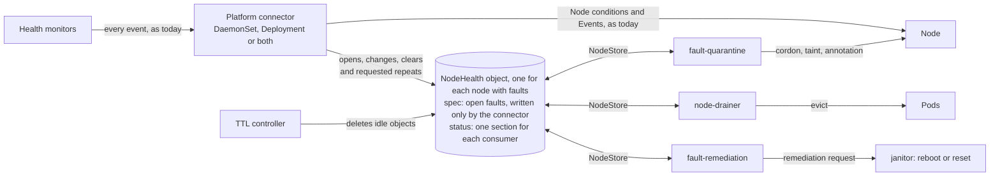
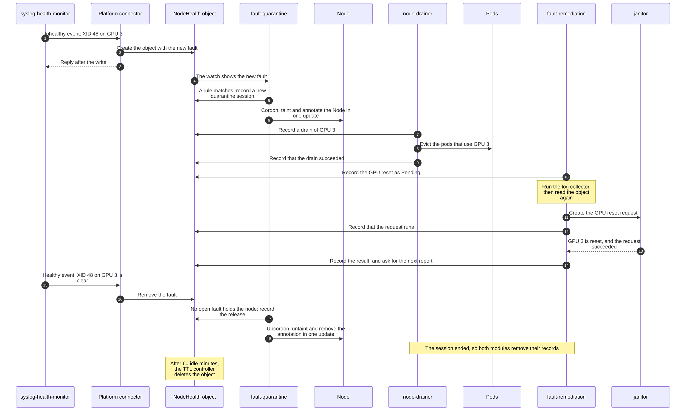

# ADR-067: Kubernetes-Native Remediation Without a Database

## Summary

- **Remediation without a database.** In Kubernetes mode, the three consumers use one `NodeHealth` object for each node with faults instead of a database. The consumers of health events are fault-quarantine, node-drainer and fault-remediation. The mode is for small clusters, where the work to operate a database costs more than the database gives. Large clusters keep a database.
- **Only open faults, written only when they change.** A NodeHealth object keeps the faults that are open now, not a history of events. Each consumer records its progress in its own section of `status`. Monitors still send every event. The platform connector writes the object only when a fault opens, changes or clears, or when a consumer or monitor asks for a repeat. So a GPU that logs an XID (a GPU driver error) 600 times a second causes one write ([details](#write-rate)).
- **A generic connector.** The connector reads a NodeHealth object and its Node by name, only for nodes that it gets events for. It never lists or watches them, so a connector on every node adds no list or watch load. Two rules of the `HealthEvent` data model tell it which events report the same fault and which faults a healthy event clears. It has no rules for particular monitors, so monitors set optional metadata keys on the few events that need other treatment ([keys](#keys-that-monitors-set)). It keeps nothing in memory that it needs after a restart, so its DaemonSet and the deployment platform connector run the same code.
- **One reconcile loop for all providers.** Each consumer runs one reconcile loop on `NodeStore`, a new store-client interface. The MongoDB, PostgreSQL and new `kubernetes` providers implement it. Each pass reads a view of one node and does only the work that is left ([details](#how-the-providers-fit-store-client)). The fault-quarantine module releases a node only when a newer version of the same object shows that the faults of the quarantine cleared. Data that is not there, or a re-created object, never releases a node.
- **What we give up.** Rules can no longer match a few rarely used event details, such as the event message ([list](#changes-for-rules)). The health-events-analyzer, the event exporter and csp-health-monitor do not run in this mode yet. Kubernetes mode supports up to about 2,500 nodes with a 16 GB etcd. This figure assumes the default standing limit of the circuit breaker in this mode: at most 10% of GPU nodes cordoned at one time ([details](#scale-and-etcd-usage)).

## Context

This ADR proposes remediation without a database, because of two problems. First, someone must operate the MongoDB or PostgreSQL database that the chart can install: set its storage and size, upgrade it and monitor it. Remediation stops while the database is down. In a small cluster, this work can cost more than remediation gives.

Second, the consumers act on each event once, so a lost event is a fault that no consumer remediates. The DaemonSet connector replies to a monitor before it writes the event, so a crash loses the events in its queue. Bugs in restart recovery can also skip an event.

## Decision

We add **Kubernetes** as a third datastore option for small clusters, next to MongoDB and PostgreSQL. The Helm value `global.datastore.provider: kubernetes` selects it. The default does not change. This ADR proposes to supersede [ADR-027](027-kubernetes-data-store.md), which stores one object for each health event ([why](#one-object-per-health-event-adr-027)). The first diagram shows the parts of this mode, and the list below explains them.



1. The platform connector, as a DaemonSet on each node or as the Deployment, compares each event with the node's open faults. It writes new faults, changed faults and clears to one cluster-scoped `NodeHealth` object for the node before it replies to the monitor. A clear is a healthy event that removes a fault. A repeat of an open fault causes no write. The exceptions are a repeat that a consumer asks for with a report-again request (`reportAgainUpTo`), and a repeat on which the monitor sets `forcePublish` ([details](#how-the-connector-writes-events)). A consumer asks when it must decide again at the next report of a fault, for example after a failed drain or a finished remediation.
2. The three consumers, fault-quarantine, node-drainer and fault-remediation, read the NodeHealth objects instead of the database. Each works like a Kubernetes controller. In each pass for a node, it compares the open faults with its own records and does the work that is left. It gives each open fault, as a health event, to today's decision code. Before each cordon, eviction or remediation request, it records the action in a write that fails if the object changed after its view. The fault-quarantine module releases a node only when a newer version of the same object shows that the faults of the quarantine cleared.
3. Three components use the database for more than remediation, so they do not run in this mode yet. Their support is follow-on work. Of the 22 default rules of the health-events-analyzer, 21 read past events, also in their datastore-neutral form. The event exporter sends every stored event to an HTTP endpoint. The csp-health-monitor keeps each planned maintenance event and its status in the database. Only these three use the event methods of store-client, which return an error in the `kubernetes` provider ([details](#how-the-providers-fit-store-client)).
4. All NodeHealth code is in a new `kubernetes` provider of store-client, which registers in the same way as the PostgreSQL provider. Each module uses it as a library, in its own process, so no new component stands between the modules and the API server ([why](#a-store-proxy-deployment)). The connector writes each batch of events through one store-client method. The `kubernetes` provider applies the batch to the objects. Each consumer runs one reconcile loop on `NodeStore`, a new store-client interface for the state of one node, which all three providers implement. Each difference between the modes is in a provider ([details](#how-the-providers-fit-store-client)).
5. The TTL controller, which deletes janitor's remediation requests today, moves out of janitor into its own Deployment. It deletes a NodeHealth object that has no open fault and no consumer record, after it stays unchanged for 60 minutes ([Idle objects](#idle-objects)).

**One fault from detection to recovery.** The second diagram follows one fault in the simplest case. A quarantine session of [ADR-064](064-node-and-device-selection.md) is one quarantine of a node, from its start to its release or cancel. GPU 3 on node `gpu-node-17` logs XID 48, a memory error that calls for a GPU reset. The example assumes that partial drains, GPU resets and the log collector are turned on.



## Implementation

### The NodeHealth object

The connector creates the NodeHealth object of a node when it writes the first fault of the node. The object has the name of the Node, and the Node is its owner. So each Node has at most one object, and Kubernetes deletes the object when it deletes the Node. The consumers and the TTL controller never create an object ([Idle objects](#idle-objects)).

A new Node with the same name can appear before Kubernetes deletes the object of the old Node. So the connector and the consumers compare the owner UID of the object with the UID of the Node. The consumers treat an object with another UID as not there. The connector rejects events for the node with gRPC `UNAVAILABLE` until the garbage collector deletes the old object. The monitor sends these events again, and the next event creates a new object.

Only the connector writes `spec`, which holds the open faults of the node. The faults come from health events, also from components that report about other nodes, such as lifecycle-manager. Each consumer writes its decisions and its progress in its own section of `status`. Role-based access control (RBAC) keeps the connector out of `status` and the consumers out of `spec`. An admission policy keeps each consumer in its own section.

**Faults and devices.** A fault is one error code that one check reports for one device. An event with no error code gives one fault, and an event with more error codes gives one fault for each code. Database mode is similar, because the fault-quarantine module keeps one key in its Node annotation for each error code and entity. A check entry holds `agent`, `check`, `componentClass` and `version` one time for all its faults. These four fields are part of the identity of each fault.

A device entry holds the faults of one check that name the same identity entities. Identity entities are all entities of the event, except the types that its `detailEntities` key lists ([keys](#keys-that-monitors-set)). So in this document, a device is one set of identity entities, not always one part of the hardware. One GPU can have more than one device entry. Each fault has its own `isFatal`, action and other fields, because one device can have errors that need different actions. A device entry with no entities is for the whole node.

**Size and cap.** An object with one fault is about 1.6 KB. An object holds at most 128 device entries and 256 faults, and a device entry holds at most 8 entities. This cap is the same for each health monitor. It holds a full failure of any common GPU node, where each GPU, NVSwitch and NIC port fails ([sizes](#scale-and-etcd-usage)). It also holds the faults that the shipped components send about other nodes, with their default values.

A new fault needs room for one fault, and also for one device entry if its device is new. Faults that are not fatal can use at most 96 device entries and 192 faults. So 32 device entries and 64 faults stay free for fatal faults. Repeats, changes and clears need no room, so a full object never rejects them. The connector keeps the first 8 identity entities of an event, in their order, and drops the others. When the last fault of a device entry clears, the connector removes the device entry too.

When a new fault has no room, the connector rejects it with the gRPC code `RESOURCE_EXHAUSTED`, and a metric counts it. The publish clients keep their current behavior. The socket client, which sends to the DaemonSet connector, gives this reply to the monitor at once. The direct client, which sends to the deployment platform connector, tries again for up to 5 minutes, its retry window, and then returns an error. During that time, the later events of that monitor wait, also its events about other nodes.

Each shipped health monitor sends the event again later, so the fault is late but not lost. A preflight check runs one time, so its fault comes again only when the check runs again. If a fault in the object already holds the node, the node stays quarantined during this time.

**Decisions for each fault.** The fault-quarantine module keeps no decision for each fault. Its Node annotation lists the faults that hold the node, and each pass evaluates the other open faults again with no write. The node-drainer and fault-remediation modules keep the decisions of [ADR-064](064-node-and-device-selection.md) for each fault, as database mode keeps them on each event. They identify a fault by its write number, `seq`. When the connector writes a fault again, the fault gets a new number, so each module decides again, as for a new event today.

In each write, a module removes the numbers of faults that are not open now, but only from the lists `faults`, `skipped` and `stopped`. A drain record or a remediation record stays until its session ends. The next table shows where the `kubernetes` provider keeps each decision that ADR-064 records.

| ADR-064 | Kubernetes mode |
|---|---|
| Quarantine session | `faultQuarantine.session` |
| `drainDecision.method` and `drainDecision.ruleSet` | `nodeDrainer.method` and `nodeDrainer.ruleSet`, one of each for each session |
| `drainDecision.scope` | The scope of the drain record |
| `drainDecision.reusedFrom` | Not needed, because the drain record lists each fault that it covers |
| Drain status `Stopped` | `nodeDrainer.stopped` |
| Drain status `Succeeded` or `AlreadyDrained` | A `Succeeded` drain record of the session lists the fault, or `nodeDrainer.skipped` lists it |
| `remediationDecision.action` and `remediationDecision.ruleSet` | The `action` and `ruleSet` of the remediation record |
| `remediationDecision.stopped` | `faultRemediation.stopped` |

**Example.** The example shows all fields of the object, and its comments explain them. The object stores nothing that other data gives: no summary of the faults, no history of remediations and no count of repeats. Node `gpu-node-17` is an HGX node with partial drains and GPU resets turned on, which are off by default.

The fault-quarantine module started session 8 for XID 48 on GPU 3, which the connector first wrote as fault 38. Unlike the second diagram, an operator deleted the first reset request, so the reset failed and the connector wrote the fault again as fault 41. Now the node waits for a reboot, because GPU 5 fell off the bus and a maintenance request also asks for a reboot.

```yaml
apiVersion: healthevents.dgxc.nvidia.com/v1alpha1
kind: NodeHealth
metadata:
  name: gpu-node-17                           # the name of the Node
  uid: 0d4b6c3e-2a91-4f7e-b8d5-6c1f0e9a2b47  # the first part of each event ID
  generation: 37                              # changes only when spec changes; a connector write fails if it changed
  ownerReferences: [{apiVersion: v1, kind: Node, name: gpu-node-17, uid: 78ff5c0a-e565-4211-8378-6ddb47ee2a6b}]
spec:                                         # only the connector writes spec
  seq: 52                                     # the last write number; a write with no fault, such as a clear, also takes one
  checks:
  - agent: syslog-health-monitor              # agent, check, componentClass and version make the check entry
    check: SysLogsXIDError
    componentClass: GPU
    version: 1
    devices:
    - entities: ["PCI=0002:00:03", "GPU_UUID=GPU-67fec4a7-a3e1-385c-0c98-4361b4a372ca"]   # GPU 3: at most 8 identity entities
      faults:
      - errorCode: "48"                       # no errorCode when the event has none; optional: customRecommendedAction, quarantineOverrides
        isFatal: true                         # a fatal fault stays fatal while it is open
        recommendedAction: COMPONENT_RESET
        seq: 41                               # event ID <uid>-41; first written as 38, written again after the failed reset
        reportedAt: "2026-09-16T12:44:05Z"    # connector clock, for people, Events and metrics only
      - {errorCode: "64", isFatal: true, recommendedAction: COMPONENT_RESET, seq: 42, reportedAt: "2026-09-16T12:44:05Z"}
    - entities: ["PCI=0002:00:05", "GPU_UUID=GPU-9b1d2f30-7c44-11ee-b962-0242ac120002"]   # GPU 5, which fell off the bus
      faults: [{errorCode: "79", isFatal: true, recommendedAction: RESTART_BM, seq: 44, reportedAt: "2026-09-16T12:46:12Z"}]
  - agent: gpu-health-monitor                 # another check entry, so GPU 3 has a second device entry
    check: GpuPcieWatch
    componentClass: GPU
    version: 1
    devices: [{entities: ["GPU=3", "PCI=0002:00:03", "GPU_UUID=GPU-67fec4a7-a3e1-385c-0c98-4361b4a372ca"], faults: [{errorCode: DCGM_FR_PCI_REPLAY_RATE, isFatal: true, recommendedAction: CONTACT_SUPPORT, seq: 43, reportedAt: "2026-09-16T12:45:30Z"}]}]
  - agent: nic-health-monitor
    check: InfiniBandStateCheck
    componentClass: NIC
    version: 1                                # an override rule of the operator set drainOverrides.skip on this port fault
    devices: [{entities: ["NIC=mlx5_2", "NICPort=1"], faults: [{isFatal: true, recommendedAction: CONTACT_SUPPORT, drainOverrides: {skip: true}, seq: 45, reportedAt: "2026-09-16T12:46:40Z"}]}]
  - agent: lifecycle-manager                  # sends faults about other nodes; check and action come from the maintenance request
    check: PlannedMaintenance
    componentClass: NODE
    version: 1                                # no entities: the fault is for the whole node; isFatal false: stored because the event sets the metadata key recordNonFatal; attributes holds the keepMetadata keys
    devices: [{entities: [], faults: [{isFatal: false, recommendedAction: RESTART_BM, attributes: {maintenanceRequestName: mr-7f3c2a}, seq: 46, reportedAt: "2026-09-16T12:47:02Z"}]}]
  - agent: slurm-drain-monitor                # a custom fatal pattern of the operator; no shipped ruleset matches it
    check: SlurmNotResponding
    componentClass: NODE
    version: 1                                # not held: fault-quarantine evaluates it again in each pass, with no write
    devices: [{entities: ["v1/Pod=slurm/slurmd-gpu-node-17"], faults: [{isFatal: true, recommendedAction: CONTACT_SUPPORT, seq: 51, reportedAt: "2026-09-16T12:52:19Z"}]}]
status:                                       # each consumer writes only its own section
  faultQuarantine:
    session: 8                                # the quarantine session of ADR-064; plus one in the write that starts a quarantine
    state: Quarantined                        # or WouldQuarantine (dry run), Released or Cancelled
    reportAgainUpTo: 30                       # set when an operator cancelled session 7 with an uncordon
    startedAt: "2026-09-16T12:39:40Z"         # module clock, for people only
    endedAt: "2026-09-16T11:52:10Z"           # the end of session 7; the Node annotation holds the keys of faults 41 to 46
  nodeDrainer:
    session: 8                                # the session of all records below
    method: BuiltIn                           # drainDecision.method of ADR-064, chosen one time in each session
    ruleSet: ""                               # drainDecision.ruleSet; "" is the default
    reportAgainUpTo: 0                        # set when a drain fails
    drains:                                   # at most one Running or Succeeded record for each scope; the timeout counts from startedAt; a custom drain record also has request, the name of the custom drain
    - {scope: "GPU_UUID=GPU-67fec4a7-a3e1-385c-0c98-4361b4a372ca", state: Succeeded, faults: [41, 42], startedAt: "2026-09-16T12:39:58Z", finishedAt: "2026-09-16T12:40:41Z"}
    - {scope: Node, state: Succeeded, faults: [43, 44, 46], startedAt: "2026-09-16T12:45:51Z", finishedAt: "2026-09-16T12:47:30Z"}   # these faults need the whole node
    skipped: [45]                             # drainOverrides.skip, so fault 45 counts as drained
    stopped: []                               # faults that a drain stop rule set of ADR-064 stopped
  faultRemediation:
    session: 8
    reportAgainUpTo: 42                       # set when the reset for fault 41 finished
    remediations:                             # Pending, Running, Succeeded or Failed; a deleted request counts as Failed; startedSeq is the spec.seq of the view in which the module decided
    - {target: "GPU_UUID=GPU-67fec4a7-a3e1-385c-0c98-4361b4a372ca", action: COMPONENT_RESET, ruleSet: "", fault: 38, startedSeq: 39, state: Failed, request: maintenance-gpu-node-17-0d4b6c3e-2a91-4f7e-b8d5-6c1f0e9a2b47-38, startedAt: "2026-09-16T12:40:50Z", finishedAt: "2026-09-16T12:42:10Z"}   # an operator deleted the request
    - {target: "GPU_UUID=GPU-67fec4a7-a3e1-385c-0c98-4361b4a372ca", action: COMPONENT_RESET, ruleSet: "", fault: 41, startedSeq: 42, state: Succeeded, request: maintenance-gpu-node-17-0d4b6c3e-2a91-4f7e-b8d5-6c1f0e9a2b47-41, startedAt: "2026-09-16T12:44:20Z", finishedAt: "2026-09-16T12:45:10Z"}   # also covers fault 42
    - {target: Node, action: RESTART_BM, ruleSet: "", fault: 44, startedSeq: 52, state: Pending, request: maintenance-gpu-node-17-0d4b6c3e-2a91-4f7e-b8d5-6c1f0e9a2b47-44, startedAt: "2026-09-16T12:52:40Z"}   # the log collector runs; also covers fault 46
    stopped: []                               # faults that a remediation stop rule set of ADR-064 stopped
```

**Compatibility.** The NodeHealth type becomes a public interface that must stay backwards compatible. The backwards compatibility review covers its Go types, and the CRD schema comes from them.

A `helm upgrade` does not update CRDs, so each component checks at start that the installed CRD has each field that it writes. A writer keeps the fields that it does not know. So during a rolling upgrade, an older connector does not remove the fields of a newer one.

The fault fields come from the `HealthEvent` proto of today. A unit test lists each proto field as stored, rebuilt or dropped. So a new proto field fails the test until someone decides where it goes. The consumer sections hold the information of the `HealthEventStatus` of today. The consumers write them only through the typed writes of `NodeStore`. So a new status field needs a change in each provider ([How the providers fit store-client](#how-the-providers-fit-store-client)).

### Rules for every write

- **Conditional writes.** Every write, and the delete of an idle object, is conditional on the version that the writer read. So no writer overwrites or deletes a change that it has not seen. The consumers and the TTL controller use `metadata.resourceVersion`.
- **The write condition of the connector.** The connector uses the UID and `metadata.generation`, which the API server changes only when `spec` changes. So the writes of the consumers never make a write of the connector fail. The connector reads only `reportAgainUpTo` in `status`, which only goes up, so an older copy can only delay a repeat that a consumer asked for.
- **Own sections.** Each writer patches only its own section, so a writer from an older release never changes the section of another writer. An admission policy rejects a consumer write that changes the section of another consumer.
- **Failed writes.** After a failed write, the connector reads the object again and handles the event once more. If it still cannot write, it rejects the event as unavailable. It stops a batch when the request of its caller ends. So a slow replica cannot apply an old event after the monitor sends it again.
- **Record, then act.** Each consumer records what it will do before it does it. This write is conditional on the version that the consumer evaluated ([Re-check before each action](#safety-rules)).
- **Write numbers.** The connector takes a new number from `spec.seq` for each fault that it writes. A write with no fault, such as a clear, takes one number. Each fault keeps the number of its last write in `seq`, so a rewritten fault gets a new number and a new event ID. A consumer that records a point in the history of the object, such as `reportAgainUpTo`, stores the `spec.seq` of the version that it read. The `seq` of a fault is its [order key](#how-the-providers-fit-store-client).
- **Numbers only go up.** A new object has a new UID and starts again at 1. Event IDs stay unique, because each one starts with the UID. The CRD rejects a write that removes or lowers `spec.seq`, a `session` or a `reportAgainUpTo`. So a restore cannot write an older `spec` over a newer one. A restore of etcd can still bring back older objects ([Stale faults and objects](#stale-faults-and-objects)).
- **Times.** Times are for people, Events, metrics and the timers of each component. The stored times use `metav1.Time`, which keeps only seconds. Each component compares only times from its own clock. For example, the node-drainer module times each drain from the start time in its own drain record. So no rule compares times that different hosts stored.

### How the connector writes events

The connector keeps a copy of the object of each node that it gets events for, only to save reads. When it holds no copy, it reads the object by name. It also reads the Node by name, to set or check the owner reference of the object. If the Node does not exist, the connector accepts the event and writes nothing. It never lists or watches NodeHealth objects or Nodes.

Another replica may have written earlier events, so the connector reads the object again at the first event for the node on each new connection. All events of one connection must reach the same replica, as they do with a Kubernetes Service and the default gRPC client. When a repeat finds a copy older than a minute, the connector reads the object again, to see a report-again request within about a minute. It drops the copy of a node when no event for that node arrives for `global.datastore.kubernetes.copyIdleTime`, 10 minutes by default.

**The same fault, and clears.** Two rules of the `HealthEvent` data model say which events report the same fault and which faults a healthy event clears. One shared implementation follows the comments of the proto and does not use the code or the rules of a consumer. Two events report the same fault when they have the same check entry, the same error code or none, and the same identity entities. A healthy event clears an open fault of its own check entry when it has the error code of the fault or no error code. It must also have no entities, or name every identity entity of the fault.

Entities of the types that the event lists in `detailEntities` do not count, but at least one other entity must match. Only a healthy event with no entities clears a fault with no entities. For each entity, the clear rule gives the result of database mode, so a healthy event that names only some entities leaves the fault open. The `detailEntities` key lets the healthy events of gpu-health-monitor clear the faults of a replaced GPU in the same slot, as in database mode ([keys](#keys-that-monitors-set)). For each event, the connector looks for the same fault in its copy. Then:

- **A new or changed fault.** The connector writes it with a new number before it replies to the monitor. A fault changes when it becomes fatal, or when its action or override flags change. A fatal fault stays fatal while it is open. A change of only the attributes that `keepMetadata` keeps causes no write, but each write stores the attributes of its event.
- **A clear.** The connector removes the fault ([details](#how-faults-clear)). A healthy event for a fault that is not open does nothing, and a clear never creates an object.
- **A repeat of an open fault.** It causes no write, except in two cases, in which the connector writes the repeat with a new number:
  - **When a consumer asks.** A consumer that needs a new report of the open faults makes a report-again request. It sets `reportAgainUpTo` in its own section to the `spec.seq` that it read. The connector then writes the next repeat of each open fault whose `seq` is at or below the largest `reportAgainUpTo` in `status`. The repeat gets a larger number, so each request writes each fault once.
  - **When its monitor asks.** The event has the metadata key `forcePublish: "true"`, which a monitor sets when it sends a fault again on purpose. For example, gpu-health-monitor sends each fault only once. So it sets the key on the first event of each fault after each start, such as after a reboot. The connector writes such a repeat once for each fault on each monitor connection. It keeps the list of these faults in memory.

The connector does not know why a consumer asks. The consumers ask so that the next report of a fault acts as the next event does in database mode. The fault-quarantine module asks after a cancel and after a `CREATE` reset of the circuit breaker ([Safety rules](#safety-rules)). The node-drainer module asks when a drain fails, so each fault of the drain gets a new drain decision at its next report. The fault-remediation module asks when a remediation attempt finishes, so the next report lets it retry or escalate. As in database mode, a repeat that the connector writes after the start of an attempt counts as a newer event of the fault.

**Which events the connector uses.** Like the fault-quarantine module today, the connector uses only `EXECUTE_REMEDIATION` events, healthy or unhealthy, because `STORE_ONLY` and `STORE_AND_ANALYSE` events must not change the cluster. Kubernetes mode keeps no record of them, so an install that needs them can forward them with the gRPC sink connector. The connector also skips unhealthy events that are not fatal, unless `global.datastore.kubernetes.recordNonFatal` is `true`, or the event sets `quarantineOverrides.force` or the metadata key `recordNonFatal: "true"`. The connector does not filter unhealthy events by the rules of fault-quarantine, because these rules read Node labels that can change. Of the shipped rulesets, only the ruleset for maintenance requests matches events that are not fatal, so lifecycle-manager sets the key.

The connector reads each event after the stages that add Node metadata and apply override rules, and before the deduplication stage. That stage is off by default and never drops an event. It only changes a repeated event to `STORE_AND_ANALYSE`, so that the fault-quarantine module and the Node conditions ignore it. So a stale duplicate decision cannot hide a fault that came back, for example after a connector replica missed the clear. In database mode, the database writer still gets each batch after every stage, as today.

**Malformed events.** The connector rejects an event when an entity type is empty or contains `=`. The object stores each entity as `type=value`, and `View` splits it at the first `=`. So an entity value can contain `=`.

**Replies.** For each batch, the connector makes one write for each node, with every event for that node that it can write. Then it sends the first of these replies that applies, or success when none applies. `UNAVAILABLE`: a read or a write failed, or the object still names the UID of an earlier Node with the same name ([The NodeHealth object](#the-nodehealth-object)). `RESOURCE_EXHAUSTED`: a new fault waits for room in a full object. `INVALID_ARGUMENT`: every rejected event is malformed, so the publish clients do not send such an event again.

### Keys that monitors set

The connector has no rules for particular monitors, checks, entity types or error codes. Instead, a monitor marks an event that needs other treatment with an optional metadata key. The `HealthEvent` schema does not change. The connector does not store the keys in the object. In database mode, the keys go into the database with the other metadata and change nothing. A key that lists items separates them with commas.

| Key | What the connector does | Where it is set |
|---|---|---|
| `forcePublish: "true"` | Writes this repeat of an open fault, once for each fault on each monitor connection | The first event of each fault after gpu-health-monitor starts |
| `recordNonFatal: "true"` | Stores this unhealthy event when it is not fatal ([Which events the writer uses](#how-the-connector-writes-events)) | The events of lifecycle-manager, which are usually not fatal |
| `detailEntities` | Removes the listed entity types from the event before it compares the event with the open faults and before it stores a fault. A healthy event also clears faults whose entities of these types differ ([clear rule](#how-the-connector-writes-events)) | `NVLINK` on the SXID events of syslog-health-monitor. `REG0` to `REG6` on its XID 74 events, and `GPC`, `TPC` and `SM` on its XID 13 events. `GPU_UUID` on the healthy events of gpu-health-monitor |
| `keepMetadata` | Stores the listed metadata keys in the fault's `attributes`. A change of only these values causes no write | `maintenanceRequestName` on the events of lifecycle-manager, which the shipped ruleset for maintenance requests reads. `creator_id` on the events of a tool that forces a quarantine, which the `cordon-by` Node label reads |

These keys keep today's behavior. The SXID check clears only as a whole, after a reboot, so the NVLink that an SXID event names needs no fault of its own. Without the key, the SXIDs of a complete failure of an HGX A100 node would need 96 device entries. The healthy event of a GPU reset names no link, so it does not clear XID 74, which keeps its NVLink as an identity entity. Monitors still send the entities that `detailEntities` lists, because database mode stores them and the health-events-analyzer reads some of them. A monitor without these keys, such as a custom monitor, gets safe defaults: every entity identifies its fault, so no fault clears early.

### Write rate

The connector writes the object of a node only when a fault opens, changes or clears, and for the two kinds of repeat ([details](#how-the-connector-writes-events)). It writes all changes of one batch for one node in one write. So the writes follow changes of state, not the rate of events. For example, a GPU that floods XID 137 and 145 at 120 to 600 events a second causes at most 2 writes at first. Like database mode, the connector has no write limit for each node. A limit in memory can come later, with no change to the object.

Of the shipped monitors, a NIC port that goes down and up is the fastest source, at about one write a second. In both modes, each cycle also changes the condition and the cordon of the Node, at a higher cost to etcd. The `portStateHoldDown` option of nic-health-monitor, off by default, stops both for a port that recovers within the hold-down time. As in database mode, other ways to handle such devices are out of scope. The connector keeps the `qps` and `burst` limits of its Kubernetes client, under the default API Priority and Fairness rules of the API server. A metric counts the writes for each node and reason.

### How the providers fit store-client

The `kubernetes` provider fits store-client in the same way as the PostgreSQL provider. It is in the package `store-client/pkg/datastore/providers/kubernetes`, which `store-client/pkg/datastore/providers/providers.go` imports. It registers with `RegisterProvider` in `store-client/pkg/datastore/registry.go` as `ProviderKubernetes`. Each module selects it with `global.datastore.provider: kubernetes`. All NodeHealth code stays inside the provider. A new store-client interface, `NodeStore`, gives a consumer the state of one node, for every provider:

```go
type NodeStore interface {
    // Watch sends the name of each node whose state may have changed.
    // It first sends every node with open faults or work that is not done.
    Watch(ctx context.Context) (<-chan string, error)
    // View returns the current state of one node for this consumer, whatever
    // started the pass: the faults that hold the node, the faults that the
    // consumer has not decided yet, the quarantine session and its records.
    // Each fault and record has an order key.
    View(ctx context.Context, node string) (*NodeView, error)
    // Typed writes. Each write fails if the state changed after the view.
    RecordQuarantine(ctx context.Context, v *NodeView, q Quarantine) error
    RecordRelease(ctx context.Context, v *NodeView, r Release) error
    RecordDrain(ctx context.Context, v *NodeView, d Drain) error
    RecordRemediation(ctx context.Context, v *NodeView, r Remediation) error
    RequestReportAgain(ctx context.Context, v *NodeView) error
}
```

One contract suite tests the `NodeStore` implementations of all three providers. The registry tests and the `DataStore` compliance tests also add the `kubernetes` provider. We write each consumer once, against `NodeStore`, with no change to its decision code. The consumer code compares only order keys. The scenario suite runs the consumers on all three providers. Each difference between the modes is in a provider:

| Method | MongoDB and PostgreSQL | Kubernetes |
|---|---|---|
| `Watch` | The change stream, as node names. It first sends each node that has events with work that is not done, and it sends them again at each resync. This replaces the cold start, so a missed change only delays an event. It keeps the lag metrics of the change stream, with the same names and labels | An informer on the NodeHealth objects, with a resync ([triggers](#how-the-consumers-reconcile-a-node)) |
| `View` | Each pass runs one indexed query. It reads the events of the node that the consumer has not decided yet, the events that the quarantine annotation lists, and their statuses. The statuses of today mark what each consumer decided, so `View` does not depend on what started the pass. Like the cold start of today, it skips an undecided fault that a later undecided clear supersedes. The order key is `createdAt`, and `View` returns the quarantine session as ADR-064 defines it. This query may need a compound index on the node name and the status fields | The NodeHealth object: all open faults and the sections of `status`. The order key is `seq` ([write numbers](#rules-for-every-write)) |
| `RecordQuarantine`, `RecordRelease`, `RecordDrain`, `RecordRemediation`, `RequestReportAgain` | Write the same event statuses as today, at the same points. For example, they write the quarantine status only after the cordon. So the stored data does not change. Old and new modules also work together during a rolling upgrade. `RequestReportAgain` does nothing, because every event arrives anyway | Write the section of the consumer in `status`. `RequestReportAgain` sets `reportAgainUpTo` there |
| Connector write, one method for each batch | Stores the events (`InsertManyIdempotent`) | Applies the batch to the objects ([how](#how-the-connector-writes-events)) |
| Methods of `HealthEventStore`, the change stream watcher and the filter methods of `DatabaseClient` | As today | Return an error, because the provider keeps no event history and no change stream of events. After this change, no consumer calls them: the database providers use them inside `NodeStore`. Only the health-events-analyzer, the event exporter and csp-health-monitor call them, and these three do not run in this mode. The `DataStore` compliance tests expect this error |

**The difference that a consumer can see.** In Kubernetes mode, the view holds all open faults, because the fault-quarantine module keeps no decision for each fault. In database mode, it holds the faults that hold the node and the events that the consumer has not decided yet. So a change of a rule or a Node label can act at the next pass for the node. In database mode, such a change acts at the next event of the fault. This ADR adds no mechanism for such changes, which are out of scope, and the standing limit bounds the effect ([Safety rules](#safety-rules)).

### How the consumers reconcile a node

Each consumer works like a Kubernetes controller. It puts the node names from `Watch` in its own queue, which holds each node at most once. For each node in the queue, it runs one pass. The pass reads the view and the live state, such as the Node, its pods, the custom drains and the remediation requests. It compares the open faults with its own records and does only the work that is not done yet. The next consumer reads these records, as the Deployment controller reads ReplicaSet status.

After a restart, the consumers read the current state. They do not replay events. A pass that finds no work to do writes nothing. As today, the consumer queues the node again with a backoff when a pass fails. It also queues the node again after a delay while a drain or a remediation request runs, so new nodes do not wait behind it.

**The queue.** The queue belongs to the consumer in every mode, so node-drainer keeps its priority queue, with node names instead of events. The Node and pod changes that a consumer watches go into the same queue. In Kubernetes mode, `Watch` uses an informer cache with only the fields that the consumer uses. The consumer reports the length of its queue and the wait of the oldest node.

A write of a consumer to its own section does not queue the node for that consumer. In Kubernetes mode, each resync queues every node, and a change of one of these inputs queues the node, even during a pass:

| Consumer | The node goes into the queue when this changes |
|---|---|
| fault-quarantine | `spec`, or the cordon, the taints or the annotations of fault-quarantine on the Node. So an uncordon or untaint by someone else starts a pass. Also after a reset of the circuit breaker |
| node-drainer | `spec`, the section of fault-quarantine, its annotation on the Node, which lists the devices to drain, or the pods and custom drains of the node |
| fault-remediation | `spec`, or the sections of fault-quarantine and node-drainer, but not a Node annotation |

**The input of the decision code.** The consumers keep their decision code: the rules of fault-quarantine, the drain choices of node-drainer, and the actions and request templates of fault-remediation. This code gets one `HealthEvent` for each open fault. In Kubernetes mode, `View` takes these events from the object, in the order of the object. The object keeps no event message. The connector does not write most repeats, so a stored message would describe an old event.

| `HealthEvent` field | Taken from |
|---|---|
| `nodeName`, `agent`, `checkName`, `componentClass`, `version` | The name of the object, and the check entry of the fault |
| `errorCode`, `isFatal`, `recommendedAction`, `customRecommendedAction`, `quarantineOverrides`, `drainOverrides`, `metadata` | The fault, and its attributes for `metadata`. A fault without an error code gives an event without one |
| `entitiesImpacted` | The entities of the device entry of the fault, each split at its first `=` into a type and a value |
| `generatedTimestamp`, and the creation time of the stored event | `reportedAt`. For node-drainer, the creation time is the start of its drain record, so it times each drain on its own clock |
| `message`, `isHealthy`, `processingStrategy` | Always empty, false and `EXECUTE_REMEDIATION`, because the object keeps no message, the view holds only open faults, and [other events never change the object](#how-the-connector-writes-events). So the templates that read `.HealthEvent.Message`, and the `quarantineHealthEvent` Node annotation, get no message. The `cordon-reason` Node label of a forced quarantine gets the check name. Operators still see the messages in Node conditions and Events |
| `id` | The UID of the object, a dash and the `seq` of the fault. It stays the same after a restart. It changes when the connector writes the fault again. It is valid in the names that node-drainer and the shipped remediation templates build from it. The annotation of fault-quarantine keeps the first event that it recorded for a fault, until the recommended action changes. So the consumers match a fault in the annotation by its check entry, error code and entities |

**Quarantine sessions.** The fault-quarantine module adds one to `session` in the write that starts a quarantine. This number is the quarantine session of [ADR-064](064-node-and-device-selection.md). The node-drainer and fault-remediation modules write the session of their records in their own `session`. A session is active while the state of fault-quarantine is `Quarantined`, or `WouldQuarantine` for a module in dry run.

**The passes.** Each consumer runs the same steps with every provider. The field names below are those of Kubernetes mode. The fault-quarantine module runs four steps in each pass. While the circuit breaker is tripped, steps 3 and 4 wait ([Safety rules](#safety-rules)).

1. **Finish half-done steps.** If the module recorded a release or a cancel and its annotations are still on the Node, it finishes that step. If it recorded a quarantine and its annotation is not on the Node, it cordons the node when an open fault still matches. Otherwise, it records `Released`. When dry run is turned off, it treats a `WouldQuarantine` session as not applied, and the cordon starts a new session ([Dry run](#safety-rules)). While the circuit breaker is tripped, this step finishes only a recorded release or cancel.
2. **Find a quarantine that someone else ended.** If its annotation is on the Node but its cordon or a taint is gone, the module records `Cancelled` and a report-again request. Then it removes its annotations from the Node. In dry run, the module does not record a cancel when the cordon or a taint is not there.
3. **Evaluate.** The module gives the shared rulesets each open fault that is not in its annotation and whose `seq` is above `reportAgainUpTo`. On a match without an active session, it records the start of a session. Then it cordons, taints and annotates the node in one Node update. On a match during a session, it adds the fault to its annotation and applies its taints, as today. A fault that no rule matches costs no write.
4. **Release.** The module removes the keys of its annotation that no open fault of the same object has. Before it removes the last key, it records `Released`, in a write that fails if the object changed after the view. Then one Node update uncordons the node and removes its taints, its annotations and the last key.

**The node-drainer and fault-remediation pass.** Each pass of these two modules runs these steps:

1. **Session check.** When the quarantine session changes or ends, the module first stops the work of its old session. The node-drainer module deletes the custom drains that its records name. The fault-remediation module updates its Node annotation as today: `KeepAttemptsForValidation` after a release, and `ClearRemediationState` after a cancel. Then, in one write, the module removes its records and decisions and sets the current session, but keeps `reportAgainUpTo`. The module writes nothing for a new session before this write, so a crash between the steps only repeats them.
2. **Drain decision.** The node-drainer module takes each open fault that is in the annotation of fault-quarantine but not yet in its own section. A fault with `drainOverrides.skip` goes to `skipped`. A fault that a stop rule set for drains matches goes to `stopped`. If a `Running` or `Succeeded` drain record has the scope of the fault, or the scope `Node`, the fault joins that record. Otherwise, the module writes a `Running` drain record for the fault.
3. **Drain result.** The node-drainer module evicts the pods or creates the custom drain that the drain record names. Then it records `Succeeded` or `Failed`. When a drain fails, it also sets `reportAgainUpTo`, so it decides again at the next report of the fault. It checks, waits for and deletes a custom drain only by the name in its record. Each of its writes also removes the numbers of faults that are no longer open.
4. **Remediation records.** A remediation record is `Pending` until its request exists, then `Running` until the request finishes, then `Succeeded` or `Failed`. For a `Pending` record, the fault-remediation module runs the log collector and reads the object again. Then it creates the remediation request, with a name from the event ID of the fault. So after a crash, the next pass does not create a second request, because it finds the first one. A `Running` record whose request is gone counts as `Failed`, for example when an operator takes a node back from an external repair.
5. **Remediation candidates.** A candidate is a fault in the annotation of fault-quarantine that is still open, counts as drained and is not in `stopped`. The fault-remediation module gives each candidate to the shared decision code: the rule sets of [ADR-064](064-node-and-device-selection.md), the entry, the equivalence group and the target. A fault that a stop rule set matches goes to `stopped`. A fault with no remediation, or on a node that reached `maxRemediationAttempts`, gets no record. Otherwise, if no record covers the fault and no record is `Pending` or `Running`, the module writes a `Pending` record.

A record covers its own fault, whatever its result. If the record is not `Failed`, it also covers other faults on its target, or on any target when the target is `Node`. These are the faults of its group, or of a group that it outranks, whose `seq` is not above `startedSeq`. The `startedSeq` field is the `spec.seq` of the view in which the module decided. A covered fault gets a new attempt only when the connector writes it again. The module never retries a remediation on a timer.

### How faults clear

A healthy event removes the faults that it clears from the object at once, also when the object is full ([clear rule](#how-the-connector-writes-events)). After a reboot, syslog-health-monitor first sends one healthy event with no entities for each of its checks, which clears every fault of the check. Then the monitor reads the log of the new boot from the start. The connector applies the events of each monitor in the order in which they arrive, not by their timestamps. So an XID that the GPU logged before the clear arrives after it and opens the fault again. A clear can still wait behind a rejected new fault ([Negative](#negative)).

**Release by the keys of the Node annotation.** As today, the fault-quarantine module lists the faults that hold the node in its `quarantineHealthEvent` Node annotation. The module removes a key only when a newer version of the same object has no open fault with that key. It releases the node only at the session end ([details](#safety-rules)). Each event ID in the annotation starts with the UID of the object, so the keys stay when the object is gone or re-created ([details](#safety-rules)). As in database mode, clears have no delay, so a device that fails and recovers in cycles releases and quarantines its node each time ([details](#write-rate)).

**Clears while a consumer is stopped.** The consumers act on the faults that are open now, so no consumer has to see a clear when it happens. As in database mode at a cold start, a fault that opens and clears while the fault-quarantine module is stopped does not quarantine the node. The next pass removes the key of a fault that cleared meanwhile, and the module releases the node at the session end. The node-drainer and fault-remediation modules act only on open faults, so no drain or remediation starts for a fault that cleared.

### Safety rules

- **Release only on evidence.** The fault-quarantine module removes its cordon and taints only at the session end, as today. The session ends when no key of its Node annotation is left and no open fault that counts matches its rules. The module removes a key only when a newer version of the same object, with the same UID, shows that the fault cleared. So the module releases nothing for an object that is not there, not synced or re-created ([how faults clear](#how-faults-clear)). A lost `status` also releases nothing, because the faults in `spec` still hold the node.
- **Validation after remediation.** A NodeHealth object drops a fault once it clears, so the fault-quarantine module records which faults need validation in its Node annotation, as today. When the last fault clears, the module checks the drain in `status.nodeDrainer` and creates the `ValidationRequest` before it records the release. It must do this first, because the node-drainer module removes its records when the session ends. After a restart, it finds the `ValidationRequest` and leaves the cordon and taints for lifecycle-manager, which removes them after validation passes, as today.
- **Release with validation.** The release removes the annotations of the module and leaves the cordon and taints for lifecycle-manager. Step 1 of the fault-quarantine pass treats this as a finished release.
- **Re-check before each action.** Before each cordon, eviction or request, a consumer reads the object and the Node again from the API server, not from its cache. A conditional write just before the action counts as the read of the object, because the write fails when the object changed.
- **Remediation only after a drain.** A remediation starts only for an open fault that a succeeded drain of the current quarantine session lists, or that the node-drainer module skipped. As in database mode, a reboot can follow a partial drain. [ADR-064](064-node-and-device-selection.md) leaves that check to later work. A remediation never starts while another remediation request for the node runs. A fault that a record covers gets a new attempt only when the connector writes it again ([How the consumers reconcile a node](#how-the-consumers-reconcile-a-node)).
- **Circuit breaker.** The circuit breaker and its [settings](../configuration/fault-quarantine.md#circuit-breaker) limit the quarantines as today. While it is tripped, the fault-quarantine module starts no quarantine and records no new release, but it still records a cancel. After a `RESUME` reset, it evaluates the faults that are open now. After a `CREATE` reset, it sets `reportAgainUpTo` to the current `spec.seq` in the object of each node that it does not quarantine. So these faults count only from their next report, as a `CREATE` reset skips the queued events in database mode.
- **Standing limits.** The breaker also has two standing limits on the number of cordoned nodes, `maxCordonedNodes` and `maxCordonedPercentage`, which are off by default in database mode. In Kubernetes mode, the default of `fault-quarantine.circuitBreaker.maxCordonedPercentage` is 10. A value that the user sets overrides this default. The figure of about 2,500 nodes in [Scale and etcd usage](#scale-and-etcd-usage) assumes this default. Kubernetes mode changes only this default and adds no limit of its own.
- **Uncordons and untaints by someone else.** An operator or another controller can uncordon the node, or remove a taint of the fault-quarantine module, while a fault is open. The module then records `Cancelled` and sets `reportAgainUpTo` to the `spec.seq` that it read, in one write that is conditional on that version. Then it removes its annotations from the Node, but leaves its taints and the labels of its rules, as today. A fault with a `seq` not above `reportAgainUpTo` counts again only after its next repeat, which the same field asks the connector to write. If the node has no NodeHealth object, the module records nothing and only removes its annotations.
- **Records from an earlier quarantine session.** A drain record, a remediation record, or a `skipped` or `stopped` decision counts only when its section names the current quarantine session. That session must also be active ([Quarantine sessions](#how-the-consumers-reconcile-a-node)). So after an uncordon and a new quarantine, the node-drainer module drains the node again before the fault-remediation module acts. This drain also evicts the pods that started on the node in between.
- **Dry run.** In dry run, the fault-quarantine module records `WouldQuarantine` and writes its annotation without a cordon. A consumer that is not in dry run treats `WouldQuarantine` as no quarantine and does nothing for the node. The node-drainer and fault-remediation modules mark each record that they write in dry run as a dry-run record. Only consumers that are also in dry run count these records, as in database mode. When dry run is turned off, the fault-quarantine module starts a new session or records `Released`, so records from dry run never count.
- **Safe restarts and a full etcd.** Every step is safe to repeat, because all three consumers record what they will do before they do it. A crash test restarts each component after each write and checks the result. When etcd is full, no new cordon, drain or remediation request starts, for the same reason. During a rollout, two pods of one component can run at once. With conditional writes and request names from event IDs, the second pod fails its write or finds the request of the first pod.

### Idle objects

Because Kubernetes has no built-in expiry for custom resources, the TTL controller moves out of janitor into its own Deployment. The TTL controller still deletes janitor's remediation requests as today, with the same `ttl` values. It runs when janitor is installed or in Kubernetes mode, so Kubernetes mode does not depend on janitor. In database mode, it does not watch NodeHealth objects, so it does not need the NodeHealth CRD. For NodeHealth objects, it adds three rules that janitor's remediation requests do not use:

- **A check before the delete.** The TTL controller deletes an object only when no fault is open. The state in the section of fault-quarantine must not be `Quarantined` or `WouldQuarantine`. The sections of node-drainer and fault-remediation must hold no record in any state. The node-drainer module needs its records to delete the custom drains of a session that ended. The Node must have no quarantine annotation of fault-quarantine and no equivalence group in the remediation annotation of fault-remediation.
- **Idle time instead of a fixed expiry.** The TTL controller deletes an object only after it stays unchanged for `global.datastore.kubernetes.objectIdleTime`, 60 minutes by default. It keeps the idle time in memory, so the timer costs no write. A restart of the TTL controller only delays a delete. An idle object, which holds no node, stays after its idle time only while the TTL controller is down.
- **A conditional delete.** Before the delete, it reads the object and the Node by name, then checks the conditions again. The delete is conditional on the `resourceVersion` that it read, so it fails if a connector or a consumer wrote the object in between. A connector whose copy is older than the delete gets "not found" on its next write. It then drops its copy and handles the event as for a node that has no object.

### Stale faults and objects

- **A fault is stale** when it stays open because no monitor can send the healthy event that clears it. If a rule matched the fault, the node stays quarantined. The causes are a removed monitor, check or kubernetes-object-monitor policy, and an upgrade that renames a check or an error code. A Slurm drain that a custom fatal pattern reported can also end while slurm-drain-monitor restarts, so the monitor does not see the end. A restore of etcd opens again each fault that cleared after the backup, whose monitor does not send the clear a second time. Database mode has the same problem for each cause, for the last one after a restore of the database.
- **Nothing removes a fault** because of its age ([why](#other-ways-to-remove-faults-and-objects)). Instead, the TTL controller exports two metrics for each monitor and check: the number of open faults and the age of the oldest one. An alert on this age shows stale faults to the operator. A fix for the gaps of kubernetes-object-monitor and slurm-drain-monitor is separate work that helps both modes.
- **When the operator uncordons a node** that a stale fault holds, the fault-quarantine module records a cancel and removes its annotations, as today. The stale fault stays open, but it counts again only after the connector writes it again ([Safety rules](#safety-rules)). To remove a stale fault, the operator deletes it from `spec` of the object. The fault-quarantine module treats this delete as a clear. Do not delete the whole object, because this deletes the records of the consumers too. The fault-quarantine module removes nothing when the object is not there or has a new UID.

### Scale and etcd usage

- **Kubernetes mode is for small clusters**, but larger clusters keep a database. With the caps of [The NodeHealth object](#the-nodehealth-object), it supports up to about 2,500 nodes with one 16 GB etcd. The figure assumes the default standing limit of the circuit breaker in this mode, `maxCordonedPercentage` at 10% of GPU nodes ([Safety rules](#safety-rules)). Even 10 to 100 times today's peak event rate does not change the etcd use, which grows with nodes and fault changes, not with events. All sizes and node counts in this section are estimates. The sizes are JSON bytes, where KB, MB and GB are powers of 1,000.
- **A complete failure of a common GPU node fits the caps.** The next table shows upper bounds: nodes on which every GPU, every NVSwitch path to a GPU and every NIC port fail at once. For each GPU, it counts 3 XIDs, a fall off the bus, and 2 errors in each of 3 gpu-health-monitor checks. It also counts 2 SXIDs on each NVSwitch path, a lost DCGM connection, and a device file error on each NIC. On each NIC port, it counts the port state and 3 error counters. As in database mode, the annotation of fault-quarantine needs about 0.5 KB for each fault, of the 256 KiB that Kubernetes allows for all annotations.

| Node with everything failed | Device entries | Faults | Object with all consumer records | Annotation of fault-quarantine |
|---|---|---|---|---|
| HGX A100: 8 GPUs, 6 NVSwitches, 10 NICs with 12 ports | 123 | 235 | 49 KB | 121 KB |
| HGX H100: 8 GPUs, 4 NVSwitches, 10 NICs with 12 ports | 107 | 203 | 43 KB | 104 KB |
| HGX B200: 8 GPUs, 2 NVLink switch chips, 10 NICs with 12 ports | 91 | 171 | 37 KB | 88 KB |
| GB200 NVL72 compute tray: 4 GPUs, 5 NICs with 6 ports | 38 | 70 | 19 KB | 36 KB |
| Any node at the caps, with 8 entities in each device entry | 128 | 256 | 74 KB | 136 KB |

**The worst case for etcd** counts the live object and every old version that etcd keeps. With the 5-minute default compaction of kube-apiserver, etcd keeps each old version for up to 10 minutes, or 15 during an API server failover ([more](https://github.com/kubernetes/kubernetes/blob/master/staging/src/k8s.io/apiserver/pkg/storage/etcd3/compact.go)). The model keeps every consumer at full speed and every object at the caps, with values as long as those of the shipped monitors. Every cleared fault opens again. The model assumes 16 connector writes for each node at once, then one every 4 minutes, all for changes of state ([Write rate](#write-rate)). Each connector write causes at most one consumer write, for example when node-drainer decides a fault again after the connector writes it again.

| Worst case for each node | No standing limit | 10% standing limit (default), average |
|---|---|---|
| Live object | 74 KB | 66 KB |
| Connector writes in 10 to 15 minutes, and the consumer writes that they cause | 2.7 to 2.9 MB | 2.4 to 2.6 MB |
| Consumer writes for one quarantine: 9 for one drain and remediation, plus 5 for each further GPU to drain and reset (24 for 4 GPUs) | 0.7 to 1.8 MB | 70 to 180 KB |
| Total | About 3.5 to 4.8 MB | About 2.6 to 2.8 MB |

Without a standing limit, every GPU node can be quarantined and hold consumer records, but with the 10% standing limit only one in ten can. Each row of the next table gives the largest cluster whose worst case fits in half of the etcd space that the Node objects leave. Each Node object takes about 55 KB. The other half is for the rest of the cluster and for the old versions of the Node objects. The ranges cover 10 to 15 minutes of etcd history and 9 to 24 consumer writes for each quarantine. Because etcd stores data in whole 4 KiB pages, it needs some more space than these sizes.

| etcd size | Largest cluster with no standing limit | Largest cluster with the 10% standing limit |
|---|---|---|
| 2 GiB (self-managed) | About 230 to 310 nodes | About 370 to 410 nodes |
| 8 GB (EKS standard, AKS) | About 840 to 1,100 nodes | About 1,400 to 1,500 nodes |
| 16 GB (EKS Provisioned) | About 1,700 to 2,300 nodes | About 2,800 to 3,100 nodes |

In a 16 GB etcd, 2,500 Node objects use about 0.14 GB, so the NodeHealth objects get half of the rest, about 7.9 GB. Their worst case is about 6.4 to 7.1 GB with the 10% standing limit, and 8.6 to 11.9 GB without it, which does not fit. GPU resets take minutes, so quarantines can end and start on other nodes within 10 to 15 minutes, which the 10% column does not count. The largest cluster with the 10% standing limit then drops by about a tenth, to about 2,500 nodes for 16 GB. A device that fails and recovers many times causes more writes than the model assumes ([Write rate](#write-rate)). A planned scale test measures the real etcd size, also with NIC ports that go down and up, and faults that change on every event.

### Change an install to Kubernetes mode

A new install sets `global.datastore.provider` to `kubernetes` and `global.k8sdatastoreCrds.enabled` to `true`. Kubernetes mode has no data migration, so an install that switches starts with no NodeHealth objects. The consumers do not take over work that started before the switch. A fault from before the switch, or from an old connector pod during the upgrade, counts only when its monitor sends it again. A switch back to a database needs an empty database, because the consumers act on any events left from before the switch. A current install switches to Kubernetes mode in three steps:

1. Wait until the fault-quarantine module handles every health event, with no drain or remediation request in progress. Make sure that the circuit breaker is not tripped. Make sure that fewer than 10% of GPU nodes are cordoned, or set `maxCordonedPercentage` for the switch.
2. Apply the CRDs of the chart, because `helm upgrade` does not install them. Then upgrade with `global.datastore.provider: kubernetes` and `global.k8sdatastoreCrds.enabled: true`. Set `global.mongodbStore.enabled` and `postgresql.enabled` to `false`. Turn off the health-events-analyzer, the event exporter and csp-health-monitor.
3. Make sure that each node that is still quarantined is healthy. Then uncordon or untaint it, so that the fault-quarantine module removes its annotations, as for any cancel. Also remove the `latestFaultRemediationState` annotation of the fault-remediation module from these nodes. When a node has no object, the fault-quarantine module does not release it, so these nodes stay quarantined until then.

### Changes in each component

| Component | Change |
|---|---|
| data-models | Comments in the `HealthEvent` message define the identity of a fault and the rule for when a healthy event clears it. No field changes |
| Health monitors and lifecycle-manager | They still send every event in today's format. Of the shipped components, only gpu-health-monitor, syslog-health-monitor and lifecycle-manager add the keys of [Keys that monitors set](#keys-that-monitors-set) to some events. A tool that forces a quarantine lists `creator_id` in `keepMetadata` |
| store-client | Adds the `kubernetes` provider, which registers as `ProviderKubernetes` and holds all NodeHealth code. Adds the `NodeStore` interface, which all three providers implement ([how](#how-the-providers-fit-store-client)). |
| Platform connector, both roles | Writes each batch through one store-client method in every mode ([how](#how-the-providers-fit-store-client)). In Kubernetes mode, it replies to the monitor only after the write. For the DaemonSet role, this replaces today's reply before the write. So a monitor waits for each write, as with the deployment platform connector. Node conditions and Events stay as today, because other tools read them |
| fault-quarantine | Runs one reconcile loop on `NodeStore` in every mode, with today's decision code ([how](#how-the-consumers-reconcile-a-node)). In Kubernetes mode, it records each quarantine under a new `session` number, with `endedAt` when the quarantine ends. |
| node-drainer | Runs the same `NodeStore` loop, with today's decision code. The `drainOverrides.force` override works as today |
| fault-remediation | Runs the same `NodeStore` loop, with today's decision code. It keeps the attempt counts and equivalence groups in its Node annotation, as today. It computes its remediation state label on the Node again in each pass |
| janitor and the TTL controller | The TTL controller moves out of janitor ([how](#idle-objects)). It still deletes janitor's remediation requests as today, 14 days by default. It also deletes idle NodeHealth objects. It exports the metrics of open faults ([why](#stale-faults-and-objects)). Janitor still carries out the remediation requests |
| Helm chart | Adds `kubernetes` as a value of `global.datastore.provider`, and these keys under `global.datastore.kubernetes`: `recordNonFatal` (default `false`), `copyIdleTime` (10 minutes) and `objectIdleTime` (60 minutes). In Kubernetes mode, `fault-quarantine.circuitBreaker.maxCordonedPercentage` is 10 by default ([why](#scale-and-etcd-usage)). The NodeHealth CRD, short name `nh`, goes in the current `k8sdatastore-crds` chart. The chart adds the RBAC rules and the admission policy of [The NodeHealth object](#the-nodehealth-object). It refuses Kubernetes mode while `global.k8sdatastoreCrds.enabled` is `false`, or while `global.mongodbStore.enabled` or `postgresql.enabled` is `true`. It also refuses the mode while the health-events-analyzer, the event exporter or csp-health-monitor is enabled, because they do not run in this mode ([why](#decision)) |

**Delivery order.** The work ships in three steps, and each step works on its own. First, the consumers move to `NodeStore` in database mode, with no change of behavior. The current tests, the scenario suite and the end-to-end test matrix check this step. Second, the `kubernetes` provider comes, with no change to the consumers. Third, the chart allows Kubernetes mode.

### Changes for rules

The `kubernetes` provider gives the decision code one health event for each open fault, with today's fields ([how](#how-the-consumers-reconcile-a-node)). So the shipped rulesets of fault-quarantine still match. The rule sets of [ADR-064](064-node-and-device-selection.md) for node-drainer and fault-remediation also work in this mode. In Kubernetes mode, rules can no longer select on these items:

- The event message, the entities that the event lists in `detailEntities`, and the metadata that the event does not ask the connector to keep. Examples are the register values of XID 74, the provider ID and the Node labels that the connector adds. The object keeps none of these. It also keeps at most 8 entities for each fault.
- Unhealthy events that are not fatal, unless `global.datastore.kubernetes.recordNonFatal` is `true`, or the event sets `quarantineOverrides.force` or the metadata key `recordNonFatal: "true"`. This rule is the same for every monitor, so the connector does not store the default events of slurm-drain-monitor.
- Two error codes of one event together, because each code becomes its own fault. No shipped monitor or ruleset does this.

## Rationale

- **The object stores each node's open faults, not every event, so etcd holds only bounded objects.** [ADR-002](002-storage-layer-selection.md) rejected etcd as the store for health events, because events can be large and because analysis needs aggregation queries. Even at its caps, with every consumer record, a NodeHealth object stays far below the 1.5 MiB that etcd accepts in one request ([sizes](#scale-and-etcd-usage)). Kubernetes mode runs no aggregation, because the health-events-analyzer does not run in this mode yet. Database mode keeps the store that ADR-002 chose. A follow-on design for the analyzer must answer both reasons again.
- **Custom resources fit this use.** The Kubernetes documentation names a relatively small number of relatively small objects that change relatively infrequently as the best fit for custom resources ([Declarative APIs](https://kubernetes.io/docs/concepts/extend-kubernetes/api-extension/custom-resources/#declarative-apis)). This design stores one object for each node with faults, never one for each health event, and writes it only when something changes. A NodeHealth object with one fault is about 1.6 KB and grows past a few kB only with many open faults ([Scale and etcd usage](#scale-and-etcd-usage)). The same page lists more than thousands of objects and tens of requests a second as signs of a poor fit. This design reaches these signs only when thousands of nodes have faults.
- **Faults in `spec`, consumer progress in `status`.** One write creates an object with its faults in `spec`, but faults in `status` need a second write. The split lets RBAC separate the connector from the consumers, a use that [KEP-2527](https://github.com/kubernetes/enhancements/tree/master/keps/sig-architecture/2527-clarify-status-observations-vs-rbac) accepts. KEP-2527 also drops the rule that `status` must be rebuildable from observation, so consumers can keep their records there. Consumer writes to `status` do not change `metadata.generation`, so a consumer can tell a fault change from the write of another consumer.
- **Why faults go in `spec`: restores and precedents.** A restore that drops `status`, as [Velero](https://velero.io/docs/main/restore-reference/) does by default, cannot drop open faults. Lease, CSINode and ResourceSlice also keep what node agents report in `spec`.
- **Monitors still send today's events. The connector drops repeats.** The connector already receives every event in both roles, so it is the right place to compare an event with the open faults. All other state lives in the NodeHealth object, so any connector replica can handle any event. The event recorder in client-go also limits repeats: it counts them on one Event, and its spam filter limits writes for each object. A consumer that needs the next report of a fault asks for it with a report-again request ([details](#how-the-connector-writes-events)).
- **One reconcile loop for all providers.** As Kubernetes controllers do, each consumer compares the open faults with its own records, so a restart or a missed update loses nothing. Kubernetes mode needs no ordered stream of events. Each consumer has one code path, on the `NodeStore` interface that all three providers implement ([details](#how-the-providers-fit-store-client)). So the decision code, the rules and their tests do not change. The database providers write the same event statuses as today, so old and new modules work together during an upgrade.
- **Write numbers give the order. A release needs evidence.** The `spec.seq` numbers follow the order of the conditional writes, so no rule compares times from different hosts, whose clocks can be wrong ([details](#rules-for-every-write)). The release of a node is the risky action, because a wrong release puts a faulty GPU back into service. Stale state was the largest class of the controller bugs that [Sieve](https://www.usenix.org/system/files/osdi22-sun.pdf) found (19 of 46). Releases only on evidence, conditional writes and fresh reads before each action close those paths.

## Consequences

### Positive

- **No database to operate.** Remediation works without MongoDB or PostgreSQL, so no one has to operate a database for it. A database outage can no longer stop remediation. The same design works with the DaemonSet connector, the deployment platform connector or both, so an install can turn the DaemonSet off. Operators can list the nodes that have faults, or had one in the last hour, with `kubectl get nh`. They can see the open faults of a node with `kubectl describe nh`.
- **No change to monitors.** Shipped and custom monitors still send today's events. The only additions are optional metadata keys, so the connector needs no rules for particular monitors or events. During XID floods, the connector writes only changes, instead of one database write per event.
- **No lost faults.** A crash or restart no longer loses a fault. Both connector roles write a fault or a clear before they reply. After a restart, the consumers read the current NodeHealth objects instead of old events, so a missed event no longer means a missed fault. In database mode too, a missed change only delays an event, because each start and resync finds the work that is not done.

### Negative

- **Fewer event details.** Rules and templates get no event message, and only the metadata that an event asks the connector to keep. So a custom ruleset or template that reads these details must change. An ExternalRemediationRequest made in this mode also carries less detail. Today, the consumers join one trace through the `trace_id` that the database writer adds to each event. The health events that the `kubernetes` provider returns have no `trace_id`, so each consumer starts its own trace.
- **No history and no migration.** An object keeps only open faults, so a fault that opens and clears before the fault-quarantine module handles it leaves no record. The connector does not store `STORE_ONLY` and `STORE_AND_ANALYSE` events, which database mode stores. These include the events of a node with the `nvsentinel.dgxc.nvidia.com/managed=false` label. Investigations must use logs, Node conditions and Events. Kubernetes mode has no data migration from or to a database ([how to switch](#change-an-install-to-kubernetes-mode)).
- **Components that do not run yet.** The health-events-analyzer, the event exporter and csp-health-monitor do not run in this mode yet. Until they do, nothing detects patterns over time, such as an XID that comes back many times. The analyzer rule `MultipleRemediations` also does not run, so no rule detects a node that fails again after each remediation. The `maxRemediationAttempts` option works as in database mode, because the fault-remediation module keeps its attempt counts in its Node annotation in both modes. To replace `MultipleRemediations`, a follow-on design can count the remediation requests, which janitor keeps for 14 days by default.
- **Late faults and later releases.** A full object makes a new fault late, and with the direct client the later events of its monitor wait too ([details](#the-nodehealth-object)). A clear after a GPU reset can wait behind a rejected fault, because syslog-health-monitor does not skip a line that it could not deliver. So the node stays quarantined until a reboot or an operator acts. Two healthy events that each name some of the entities of a fault do not clear it, but database mode releases the node after both.
- **Cluster size and control plane load.** Kubernetes mode supports up to about 2,500 nodes, but only with a 16 GB etcd and a 10% standing limit (estimate). This mode sets the limit by default, so the circuit breaker trips sooner than in database mode when many nodes get faults at once. The remediation load moves from the database to the API server and etcd, which an operator cannot always scale on a managed control plane. The consumers and the connector read the object and the Node again, so they make more API calls than in database mode. With the default client limit of 5 requests a second in fault-quarantine and node-drainer, a fault on many nodes at once takes longer to handle.
- **Database mode changes too.** The consumers move their database-mode loops onto `NodeStore` ([details](#how-the-providers-fit-store-client)). Their behavior must not change, but a mistake in this move can change how database installs remediate ([Delivery order](#changes-in-each-component)). In database mode, each pass also runs one indexed query, and the queue merges a burst of events for one node into one pass. The TTL controller of janitor also moves to its own Deployment in every install.

## Alternatives Considered

### Do not add this mode, or run the database on a local volume

**Rejected** because a database on a local volume still needs an operator to manage its storage and size, upgrade it and monitor it. Remediation also stops while the database is down.

### A counter that changes on every repeat (the issue's proposal)

**Rejected** because each change of the counter, also in `status`, makes the API server store and send a full new version of the object. So 600 repeats a second on one node make 600 full writes a second, about 1 GB of etcd history in 10 minutes (estimate). No decision uses the count, so the connector writes only changes of state ([Write rate](#write-rate)).

### One object per health event (ADR-027)

**Rejected** because the number of objects follows the event rate, which is how Kyverno filled etcd ([Appendix](#appendix-lessons-from-other-projects)). Even with one object for each open fault, a node can have up to 256 objects instead of one.

### Other designs of the object, its writes and its reads

- **Separate objects for monitors that report about other nodes.** Rejected because it needs a second cap, a rule for which connector writes each object, and a join of two objects in every consumer. The release write of the fault-quarantine module is conditional on one object, so it cannot cover the faults in the other.
- **Node conditions as the store.** Rejected because a Node has one condition of each type, so it cannot hold a fault for each device. Each write to a Node also goes to every watcher of Nodes. For this reason, Kubernetes moved node heartbeats to Lease objects ([KEP-589](https://github.com/kubernetes/enhancements/tree/master/keps/sig-node/589-efficient-node-heartbeats)).
- **A write limit stored in each object.** Rejected because the connector writes only changes of state, so a repeat causes no write ([Write rate](#write-rate)). A stored limit also compares times from different hosts. On a busy node, it delays new faults.
- **Times or `metadata.generation` as the order of the writes.** Rejected because times come from writers on different hosts with different clocks, so one fast clock moves every later time. If each write must store a later time, a node that starts before it sets its clock can move every later time 4 hours ahead. The API server sets `metadata.generation`, so the connector cannot put the same number on a fault in the same write. A restore also creates the object again with generation 1, while the restored faults keep their old numbers.
- **Implement the event interfaces over NodeHealth objects.** Rejected because the provider must then make up healthy events and keep a mark for each event that a consumer handled. These made-up events and marks form a second, hidden state machine, which the reconcile pass does not need ([How the consumers reconcile a node](#how-the-consumers-reconcile-a-node)).
- **A loop only for Kubernetes mode in each consumer.** Rejected because the two code paths in each consumer drift apart. Each consumer must also know its mode.

### Other ways to remove faults and objects

- **Delete a fault that fault-quarantine skipped, or an old open fault.** Rejected because the consumers see a removed fault as a clear, so they can release a node that still has the fault. A skipped fault that a monitor reports only once is then lost. To delete a skipped fault, the fault-quarantine module must also write `spec`, which only the connector writes. A monitor that repeats the fault brings it back after each delete, so each pass costs two writes. Instead, an operator removes a stale fault by hand ([Stale faults and objects](#stale-faults-and-objects)).
- **Keep cleared faults until the consumers acknowledge them.** Rejected because each clear then costs two more writes. The cleared faults also take room under the cap. The consumers do not need them, because each pass compares the open faults with the records of the consumer.
- **Delete the object when its last fault clears.** Rejected because the consumers still need their sections until the quarantine session, the drain records and the remediation records end ([details](#idle-objects)). The fault-quarantine module also releases a node only when it reads the same object, with the same UID, without the held faults.

### A store proxy Deployment

**Rejected** for now, because the proxy saves no writes and makes no read faster. The API server already serves watches from memory, and each consumer writes to the API server before it acts. All remediation also stops while the proxy is down. Every install in Kubernetes mode needs the proxy, which needs failover and an API that stays backwards compatible during upgrades. It can come later as one more provider of `NodeStore`, if the scale test shows too much memory or too many watches in the consumers.

### Other datastores

- **An in-memory store with a best-effort history.** Rejected because every install must then run a database again, which this mode exists to avoid. In this alternative, a Deployment keeps the state in memory, copies each change to the NodeHealth objects, and loads them again after a restart.
  - **No less load on the API server.** Each change that must survive still goes through the API server to etcd, and the consumers still cordon and evict through it.
  - **No faster reads.** The `kubernetes` provider already reads the objects from memory, through an informer.
  - **No storage savings.** The objects and their old versions stay in etcd, and the store adds its own copy in memory.
  - **Complex redundancy.** All remediation stops while the store is down, so the store needs replicas, replication and failover. A network split can leave two replicas that accept writes. A crash between the two writes of a change leaves two different copies.
  - **One more API to keep compatible.** Its API and its data must stay backwards compatible, because old and new modules run together during an upgrade.
  - **Little gain.** The only gain is a short, best-effort history of events.
  - **A better way to give the analyzer a history.** The gRPC sink connector and a watch on the NodeHealth objects add no service to the remediation path. The remediation requests of janitor stay for days, so this part of the history survives a restart of the analyzer.
- **An event database on each node (for example SQLite on the host).** Rejected because the consumers run centrally, so they must poll thousands of node databases that have no watch. It also needs the DaemonSet connector, which an operator can turn off. The circuit breaker limits quarantines across the cluster, so the fault-quarantine module cannot move to the nodes. The history also fails with its node, and a VM replacement or a re-image deletes it.
- **An OpenTelemetry backend as the datastore.** Rejected because these backends have no watch and no in-place update. An outage of the observability stack also stops remediation. An install can still export events to such a backend for analysis.

### The NVIDIA maintenance operator for cordon and drain

**Not part of this ADR**, because the [maintenance operator](https://github.com/Mellanox/maintenance-operator) stores no faults and so cannot replace the database or the NodeHealth objects. It can take over cordon and drain, but it sets no taints and cannot evict only the pods of one GPU. By default, it also gives a node back after `maxNodeMaintenanceTimeSeconds`, one hour, even when the node still has a fault. It has one drain mode for all pods, but the node-drainer module chooses a mode for each pod and supports custom drains.

## Notes

- **Follow-on work outside this ADR.** The health-events-analyzer, the event exporter and csp-health-monitor need their own designs for this mode. An admission policy can let each DaemonSet connector pod change only the object of its own node. This policy applies only when the monitors that report about other nodes publish to the deployment platform connector. One coordinator for remediation and for driver and network maintenance, such as the NVIDIA maintenance operator, needs its own ADR.
- **Estimates.** Numbers marked "(estimate)", and the sizes and node counts in [Scale and etcd usage](#scale-and-etcd-usage), come from the caps and limits, not from measurements. A scale test will measure them. It will also measure the memory use of the API server and the consumers, which is unknown now. All limits and times in this design are fixed, unless the text calls them configurable.

## Appendix: Lessons from other projects

| Project | What went wrong | What this design does instead |
|---|---|---|
| Kyverno | It created one report object for each admission request, faster than it could merge and delete them. Its 1.6 million objects (9.4 GB) made etcd read-only | At most one NodeHealth object for each Node. The connector writes only changes of state |
| Crossplane | Hundreds of CRDs overloaded API servers. Providers that shared one ServiceAccount replaced each other's owner references on it again and again. API server requests rose fourfold | One new CRD, and one writer for each section of a NodeHealth object |
| Dex | It created more than 500,000 objects in under 24 hours. Its cleanup listed them all and timed out | The TTL controller deletes each idle object by name. No list call looks for idle objects |
| Rancher Fleet | A status list with an entry for every resource on about 70 clusters went over etcd's request size limit. An empty cache read as "not found" and uninstalled workloads | No list of nodes inside one shared object. An empty or unsynced cache never releases a node |

## References

- NVSentinel: [ADR-027](027-kubernetes-data-store.md), which this ADR proposes to supersede. Related ADRs: [ADR-002](002-storage-layer-selection.md), [ADR-064](064-node-and-device-selection.md).
- Kubernetes: [custom resources](https://kubernetes.io/docs/concepts/extend-kubernetes/api-extension/custom-resources/); [KEP-2527](https://github.com/kubernetes/enhancements/tree/master/keps/sig-architecture/2527-clarify-status-observations-vs-rbac); [KEP-589](https://github.com/kubernetes/enhancements/tree/master/keps/sig-node/589-efficient-node-heartbeats) (node heartbeats); [etcd compactor](https://github.com/kubernetes/kubernetes/blob/master/staging/src/k8s.io/apiserver/pkg/storage/etcd3/compact.go). Storage and scale: [EKS Provisioned Control Plane](https://docs.aws.amazon.com/eks/latest/userguide/eks-provisioned-control-plane.html); [AKS etcd limit](https://learn.microsoft.com/en-us/troubleshoot/azure/azure-kubernetes/create-upgrade-delete/troubleshoot-apiserver-etcd). Lessons from other projects: [Sieve](https://www.usenix.org/system/files/osdi22-sun.pdf); [Velero restore reference](https://velero.io/docs/main/restore-reference/). Maintenance coordination: [NVIDIA maintenance operator](https://github.com/Mellanox/maintenance-operator).
